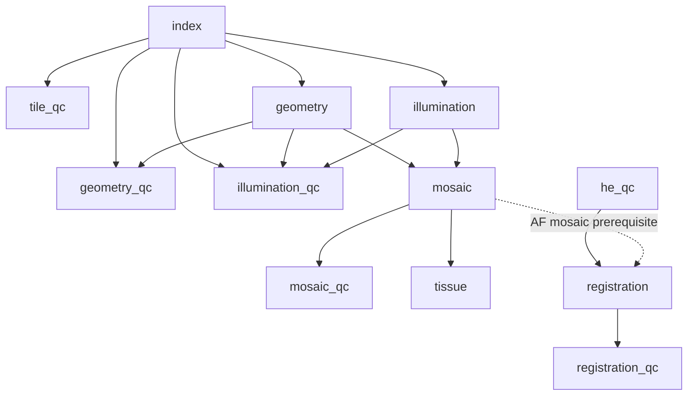

# Processing stages

Use the stage map to connect a setting to the image operation it changes:

```bash
tma-qc stages
tma-qc stages --json
tma-qc methods
tma-qc settings --config configs/methods.example.yaml --format yaml
```

These inspection commands do not process images or create a run. `stages` lists
the stage dependencies, inputs, outputs and configuration sections. `methods` lists
implemented method choices and prerequisites. `settings` resolves and validates
the configuration you supply; prerequisite assets are checked by `plan`/`run`.
The [settings reference](SETTINGS.md) gives all defaults, units and valid ranges.

## Configuration, inputs and stage order

A portable engine configuration contains parameter sections such as `tile_qc`,
`geometry` and `mosaic`. The manifest supplies tile identities, acquisition
metadata, position files, correction groups and explicit AF–H&E pairs. Input and
output selection remain command arguments:

```bash
tma-qc plan --manifest /data/tma-study/manifests/manifest.json \
  --config configs/methods.example.yaml --out /data/tma-study/runs/baseline
tma-qc run --manifest /data/tma-study/manifests/manifest.json \
  --config configs/methods.example.yaml --out /data/tma-study/runs/baseline --resume
```

The code in [workflows.py](../src/tma_qc/workflows.py) defines stage order and
dependencies. YAML can select implemented methods and change their parameters;
it cannot invent another algorithm, rearrange stages or provide missing scan
metadata. A QC stage measures evidence without silently changing positions,
discarding tiles or accepting an image.



## The nine AF stages

| Stage | Required inputs / dependencies | Method and main parameters | Saved products and interpretation |
| --- | --- | --- | --- |
| `index` | Selected manifest core and original FOVs | Fixed identity/header validation; `profile.shape`, `profile.dtype` | Verified source hashes, dimensions, type and metadata. This validates declared inputs, not tissue quality. |
| `tile_qc` | `index`; native original tiles | Fixed local gradient/detail, contrast and residual-noise measurements; `tile_qc.window`, `stride`, `prefilter_sigma` | Tile/window measurements, sampling coverage and tile-grid preview. Smaller stride adds windows and cost; it does not create calibrated defocus labels. |
| `geometry` | `index`; supplied positions, or reviewed grid and MIST runtime | `geometry.backend`: `provided` or `mist`; MIST-only `downsample`, `mist_classpath`, `timeout_seconds` | Integer native XY positions and their origin/review status. Supplied positions take precedence even when MIST is selected. |
| `geometry_qc` | `index`, `geometry`; original overlaps | Fixed overlap correlation and phase-residual evidence; `artifact_qc.evidence_pairs`, `crop_size` choose displayed examples | Overlap measurements, assessment availability and evidence sheet. It does not refit geometry. Low texture can make a phase vector unavailable. |
| `illumination` | `index`; original tiles and manifest correction group | `illumination.mode`: frozen `cidre` correction or explicit `none` | Selected-frame mapping and, for CIDRE, corrected frames and model provenance. `none` preserves original counts; fields are never fitted during this stage. |
| `illumination_qc` | `index`, `geometry`, `illumination`; original and selected frames | Fixed photometric/overlap comparison; `artifact_qc.evidence_pairs`, `crop_size` choose evidence | Correction measurements and original/selected overlap evidence. A no-correction baseline is recorded explicitly. |
| `mosaic` | `geometry`, `illumination` | Fixed weighted linear blending; `mosaic.alpha`, `chunk_rows`, `max_pixels` | Native float32 original and selected-frame mosaics, coverage and metadata. `alpha` changes blend weights; `chunk_rows` bounds row-band work; `max_pixels` guards allocation. |
| `mosaic_qc` | `mosaic` | Fixed seam evidence and previews; `artifact_qc.boundary_band_pixels`, `report.preview_size` | Mosaic QC and previews with recorded display windows. Preview size changes display cost/detail, not native reconstruction resolution. |
| `tissue` | `mosaic`; original mosaic and coverage | Fixed provisional quantile/MAD thresholds with hysteresis; `tissue.quantile`, `mad_multiplier` | Possible-tissue and unknown masks with threshold metadata. Dim covered regions remain unknown. These are not validated tissue, blur or fold segmentations. |

`runtime` controls threads, tile workers and decoded-array cache; `storage`
controls capacity estimates/reserves. These are shared operational settings,
rather than image-processing methods. `report.slide_tile` controls the batch
montage. QC measurements and image reconstruction have separate dependencies;
the workflow can preserve a reconstruction for review when diagnostic evidence
is unavailable. Execution errors, blocked prerequisites and scientific review
states are recorded separately.

## The three stages for an explicit AF–H&E pair

Pair stages run only when the manifest declares a pair. Whole-slide H&E core
extraction and pair identity review are preparation tasks.

| Stage | Required inputs / dependencies | Method and main parameters | Saved products and interpretation |
| --- | --- | --- | --- |
| `he_qc` | Declared H&E core image and its source identity | Fixed source/type/finite-pixel checks; `report.preview_size` | H&E measurements and preview for review of identity, focus, tears and folds. No automatic fold segmentation. |
| `registration` | `he_qc` and a completed AF `mosaic`; supplied transform or fitting prerequisites | `registration.backend`: `provided`, experimental `sift_affine`, or `core`. Core initializer: `sift`, `orb`, `geometry_sift`, `geometry_roma`; nested `matching`, `refinement`, `roma` settings | Native HE-to-AF transform, overlay, geometric overlap and optional aligned native H&E. A supplied transform always takes precedence. Geometric overlap is not validated tissue correspondence. |
| `registration_qc` | `registration`; independently supplied evaluation landmarks when available | Fixed held-out landmark evaluation; `qc.landmark_tolerance_pixels`, `minimum_landmarks` | Landmark errors, availability/reasons and correspondence-unknown map. Fitting matches are not evaluation landmarks; sparse landmarks do not certify dense alignment. |

Core `matching.transform` chooses similarity or affine. Core
`refinement.backend` chooses `none` or optional `bspline_mi`; optional
`geometry_roma` needs explicitly cached weights and its extra dependencies.
Legacy `registration.max_dimension`, `min_matches` and `ransac_pixels` apply
only to `sift_affine`, not the similarly named core matching settings. See the
[method requirements](SETTINGS.md#start-with-method-choices) before changing a
backend.

## Positions, overlap and preparation

The engine accepts native tile positions or can invoke configured MIST for a
reviewed grid. Its portable YAML does not include the GX10 workspace wrapper's
`schema_version`, `source`, `selection`, `paths`, `execution` or `policy` fields.
That wrapper performs study-specific selection/preparation before calling this
engine; its numbered-tile layout inference is a separate implementation and is
not included here.

An arbitrary folder with numbered images is not enough to establish scan order.
Use the [input contract](../examples/README.md) and preserve uncertainty when
positions or acquisition metadata are missing. There is no engine-wide
`overlap_ratio` setting: supplied positions determine actual overlap; the MIST
route requires its explicitly reviewed layout metadata. Do not add an assumed
overlap percentage to the YAML and treat it as a measurement.

## Compare a parameter change

1. Keep the manifest, selected cores and evaluation data fixed.
2. Inspect settings and readiness for the intended backend.
3. Choose a new output directory, change one justified parameter and run.
4. Compare native outputs and relevant QC evidence. Keep held-out landmarks out
   of fitting and tuning.

The runner saves effective settings and stage-specific fingerprints. Compatible
`--resume` verifies saved artifacts; relevant setting changes rebuild affected
work. A new directory is clearer for a scientific comparison. No method selector
or successful execution changes the requirement for image review.
