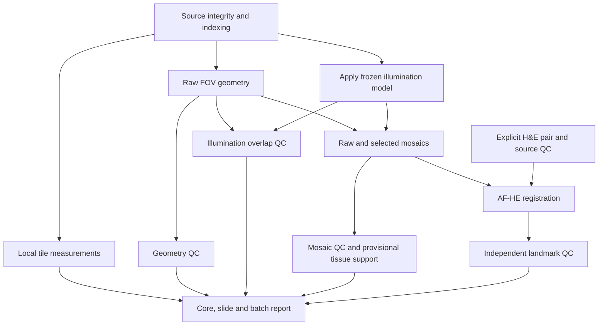

# Pipeline reference, version 0.4.1

Start with the [research guide](RESEARCH_GUIDE.md) for the run/review sequence.
[METHODS.md](METHODS.md) explains the calculations and scientific limits;
[DEVELOPMENT.md](DEVELOPMENT.md) maps the source modules and routine checks.

This is an executable review pipeline. The transfer supervisor remains separate.
Input is an explicit manifest of completed raw acquisitions, with source SHA256s,
illumination-group membership, native tile geometry and optional AF/H&E pairs.
Scientific image-quality acceptance is disabled. Every image-quality stage
currently returns REVIEW; integrity checks may return PASS.

## Install and run

Python 3.11+ is required. Install with `python -m pip install -e '.[codecs,test]'`.
The tested workstation versions are captured in `constraints-workstation.txt`.
On the current workstation the package is installed without dependency changes
in `/mnt/4TB_ssd/conda/envs/mggm-mil`. Activate that environment or use its
`bin/tma-qc` executable directly.

```bash
tma-qc demo --out /local/ssd/tma-demo
tma-qc plan --manifest /data/manifest.json --config configs/af2048.toml --out /results/run_001
tma-qc run --manifest /data/manifest.json --config configs/af2048.toml --out /results/run_001 --resume
tma-qc report --run /results/run_001
tma-qc qc --run /results/run_001 --config configs/qc_profiles.toml
```

The demo contains synthetic images and a known field. It exercises software;
it is not evidence of biological focus, illumination or registration accuracy.
`plan` is a read-only operational preflight. It hashes the selected raw/H&E
sources, checks raw TIFF headers, validates native position frames and model
assets/receipts, checks MIST grid/sequence/Java/classpath prerequisites when used,
and estimates additional AF output and scratch capacity at `--out` and the
configured cache. It does not decode raw images, run Java, or validate floating
H&E pixels. `--core` limits the preflight to named core UIDs. Reading all source
bytes can take substantial time on NAS. No output/cache directories are created.
Missing `--out`, inputs, geometry, required assets or AF capacity gives exit 2
and `ready_for_execution: false`. Invalid manifest/configuration gives exit 1.
`run` also rechecks source hashes and reads native FOVs. Its exit 0 means
execution completed, not QC acceptance; exit 1 indicates errors and exit 2
blocked stages. A successful preflight is a point-in-time operational check.

Raw inputs must contain exactly one native grayscale uint16 plane matching the
configured profile. Preflight rejects empty or ambiguous multi-plane containers,
missing/sparse segments and segments extending outside the file. Compressed
pixel contents are checked during runtime decoding. Generic model/H&E readers
also require a self-contained native plane; H&E can retain its pyramid beneath
that plane. External OME pixel references are rejected before any referenced
file is opened, so an unlisted asset cannot supply pixels under another file's
hash. These integrity checks do not establish completeness of the physical
acquisition plan.

## Processing memory and repeated reads

Raw FOVs share a per-core least-recently-used memory cache across source decode
verification, tile QC, geometry, correction, overlap QC and blending. Its default
budget is 512 MiB (`runtime.decoded_cache_bytes = 536870912`); set it to `0` to
disable retention. Only the core's declared raw paths can enter the cache. Arrays
are read-only, file identity changes invalidate entries, and every invocation
still verifies all raw source SHA256s before the stage graph can use them.
The cache is cleared at each core boundary, including interruption or failure.
The budget covers retained arrays, not the decoder, active caller arrays, blend
row-band buffers, output mappings, model fields or other pipeline memory. Lower it on small RAM
machines. Eviction affects speed without changing the calculations.

Geometry QC's unmasked raw overlap statistics can be reused for illumination QC
within the same core. Reuse requires the same raw files, native positions and
sampling. Raw support masks, supported-pixel measurements and corrected-image
measurements are still calculated using the existing rules. If geometry QC is
resumed from disk, illumination QC recomputes any absent in-memory statistics.
`stage-results.json` records per-core cache hits, misses, evictions, peak retained
bytes and reused raw overlap pairs. These are performance observations, not QC
acceptance criteria. Processing remains serial across cores.

Within each core, tile-detail QC uses four workers by default
(`runtime.tile_workers = 4`; set to `1` for serial measurements). At most that
many FOV measurement jobs are outstanding. Cache access stays on the main
thread, and measurements are collected in manifest order. Active worker images
and their calculation buffers are additional to the retained-array cache
budget. NumPy/OpenCV worker internals may use further threads; these settings
are not a process CPU limit. Workers run the same centered native-window
measurements and preserve manifest order. Window/interior sampling coverage
and explicit unavailable reasons accompany the measurements.

Raw and selected mosaics are blended together using row bands controlled by
`mosaic.chunk_rows`. They share weights and the denominator from the same native
positions. Each native pixel retains the original tile addition order and
float64 accumulation before float32 export. Full-canvas blend temporary files
are no longer needed: `peak_blend_scratch_bytes` is zero for this backend.
Row-band buffers, tile weights, active FOVs and output mappings still use memory;
native output capacity is checked before files are allocated. The public
single-output `blend` API retains its unused scratch argument for compatibility.

## Import the completed transfer

The alternative `tma-qc import-folder --raw-root ROOT --out MANIFEST` reads a
NAS-style raw AF folder tree directly. It shares acquisition parsing, source-set
selection and numeric FOV ordering with `import-copy`. Selected files are hashed
without image decoding; original slide/lamp labels and unresolved cores are
retained. It does not infer native geometry, acquisition completeness, model
compatibility or H&E pairing. See [folder import](../examples/README.md#generate-a-manifest-from-nas-style-folders).

```bash
tma-qc import-copy --database /local/controller/inventory.sqlite3 --raw-root /nas/TMA_raw/2026 --out /data/manifest.json
```

The importer opens SQLite read-only and refuses incomplete inventory or copy
errors. It recognizes `stitch`, `stitch_folder`, and unambiguous one-image-per-XY
`scan` FOV sets. Background-corrected exports, autofocus sequences, unknown
formats and ZIP files are not silently selected. It does not remove those files
from the archive. Add explicit reviewed positions and model references to the
resulting manifest. An optional `--models` JSON mapping associates group IDs
with `flatfield`, `darkfield`, and `model_metadata` paths.

Numbered FOVs are ordered numerically, including names without zero padding.
Every discovered core acquisition remains in the manifest. Ambiguous Z/exposure
sets, missing FOV indices, unsupported-only acquisitions and empty core folders
have explicit `blocked_reasons`; they may have no selected FOVs. These entries
produce blocked stage records and stay in the coverage table and review queue.
An inventory containing only blocked cores still produces a report and exit 2.
`metadata.import_coverage` records discovered, eligible and blocked counts, plus
files that could not be mapped to a known core layout. This is discovered-source
coverage, not proof that every core on the physical acquisition plan exists.

For `scan/XY/` imports, each FOV retains its `stage_xy_folder`. Lexical XY folder
order is not acquisition order: provide ID-based native positions, or reorder the
manifest FOVs using verified acquisition information and set `sequence_reviewed`
to true before MIST. Reviewing the grid direction alone does not establish the
FOV sequence.

Folder names alone do not verify camera/exposure settings or coordinate units.
The importer records these as unconfirmed. Verify compatible illumination pools
and core identity, including folders containing multiple cores. AF–H&E pairs are
explicit, not inferred from filenames. The current acquisition transfer does not
establish complete H&E source coverage.

## Stage dependencies



Geometry uses original camera data. Illumination correction does not depend on
stitched-image geometry. Raw and corrected images are blended with the same
saved positions, native pixels and alpha-1.5 linear weights. Scientific outputs
are float32 BigTIFF without clipping, smoothing, per-core gain matching or crop.
Float64 accumulation uses in-memory row bands; scientific images are exported to
native file-backed TIFFs. Coverage is a separate geometric map, not tissue.

Default geometry requires supplied integer native pixel positions. Optional MIST
estimation requires an external classpath and an explicitly reviewed image-axis
grid/scan direction. It uses block-mean uint16 registration inputs, then scales
integer positions to native pixels. This backend does not implement the earlier
pilot's SIFT graph refinement or native subpixel refinement; its result requires
review. Fractional input positions are refused rather than silently rounded.
Position JSON must be an object with all three frame declarations:

```json
{"coordinate_space":"native_pixels","axes":"XY","origin":"upper_left",
 "positions":[{"id":"1","x":0,"y":0},{"id":"2","x":1600,"y":0}]}
```

Stage micrometres, preview pixels, reversed axes and another origin are rejected.
Bare arrays and missing declarations are also rejected. For a reviewed legacy
array already known to use native XY pixels at the upper-left, save a separate
copy with this wrapper; retain the original provenance. This change never
automatically interprets stage coordinates or modifies archived geometry.

## Manifest contract

See `examples/manifest.example.json`. All identifiers used in paths are validated.
Core and AF/H&E pair UIDs must be globally distinct to keep reports unambiguous.
Relative FOV paths resolve under `raw_root`; other relative assets resolve beside
the manifest. Original and repeat acquisitions have different acquisition IDs.
Each FOV requires a source SHA256 and one explicit plane of raw uint16 data.
The default profile is 2048×2048. A different compatible profile must be explicit.
Unsigned 16-bit TIFF pixels are accepted in either byte order; conversion to
native byte order preserves their numeric values. Raw shape/axis/type headers
are checked before decoding so a misplaced large stitched image fails early.

An illumination group contains compatible acquisitions, not an arbitrary folder
of different lamps/exposures. Model field hashes are checked against their receipt.
To fit a new model, provide a JSON pool of `{ "core_uid": "...", "fov_id": "..." }`
records, at least 64 unique FOVs across four cores from one compatible group:

```bash
tma-qc fit-cidre --manifest /data/manifest.json --group GROUP_ID --pool /data/fit-pool.json --runtime /local/cidre-runtime --out /models/new-group
```

Distinct `(core_uid, fov_id)` labels are insufficient: repeated canonical paths
and identical file hashes are rejected before fitting. The model receipt saves
the verified label-to-path/hash mapping. Compatibility and biological diversity
still require review; distinct files do not prove independent tissue content.

The Java adapter/source is pinned to upstream commit
`10e1d8e8f80635349d65ead6b19cf3a85f8a225a`. Runtime class and ImageJ dependency
hashes are checked against `build.json`. The existing workstation runtime is at
`/mnt/4TB_hdd/PhoMedics/qc/work/tma2026_cidre_batch_20261017/runtime`.
No Java numerical code is changed or downloaded. Known prior method controls
remain NOT PASSED; successful fitting does not clear that status.

## AF–H&E contract

These are neighboring sections. Preserve original images and section identities.
Provided affine transforms must declare `direction: he_to_af` and
`coordinate_space: native_pixels`, and include an invertible 3×3 matrix. An
experimental `sift_affine` backend can estimate global alignment using structural
features when explicitly enabled. An optional integrated `core` backend brings
the core-registration research workflow into the same three pair stages.

Use `python -m tma_qc import-pairs --manifest af.json --pairs sections.csv --out paired.json`
to append explicit reviewed section pairs. CSV paths resolve beside the CSV;
the published manifest stores normalized asset paths and source hashes. The CSV
requires `uid,af_core,he_path,relationship`; optional columns are
`he_slide_label,transform,landmarks,af_mpp,he_mpp`. AF core UIDs and H&E source
slide labels can differ. Pairing and source completeness are not inferred from
folder names. The source manifest and images remain unchanged.

For fitted core registration set `registration.backend = "core"`, choose one
`core_method` from `geometry_sift`, `sift`, `orb` or `geometry_roma`, and optionally
set `core_config` to a research TOML. Relative core-config paths resolve beside
the main TOML; saved effective paths are absolute. The core configuration defines
working views, rotation hypotheses, consensus/spatial support checks and optional
`refinement.backend = "bspline_mi"`. Each run selects one initializer; use separate
run directories/configurations for comparisons. A supplied transform takes
precedence over estimation.

Core fitting uses original images through bounded working-view preparation.
Held-out landmark files are excluded from fitting and candidate selection.
RoMa requires the `registration-roma` extra and explicitly prepared cached model
weights; missing optional backends never silently switch methods or download
weights. B-spline refinement requires the `registration-refine` extra; rejected
or failed refinement retains the recorded global candidate for review. Neither
global fitting nor local deformation restores missing tissue or establishes
fold correction or dense biological correspondence.

Core results retain `candidates.json`, `fit-correspondences.csv`, `refinement.json`
and, when applied, `local-pull-displacement.npy`. The native global matrix and
working-view matrices are recorded together with the residual pull-map contract.
Saved research transforms can be supplied with their residual field; the field
is part of the content-addressed registration input. Native export composes the
global and local mapping and samples original H&E pixels once. Registration
configuration, runtime versions and optional cached weight hashes enter the
registration fingerprint.

H&E accepts one 2D plane or RGB/RGBA uint8/uint16 image; finite float32/float64
grayscale is also supported. Floating-point input is checked at every native
pixel, including positions outside display samples. Invalid numeric data blocks
dependent registration. Alpha is not treated as a tissue or validity mask.

Uncompressed H&E is memory-mapped read-only. Compressed H&E is decoded to a
temporary local SSD mapping, then removed when the stage closes. This needs
space for the unpacked native image; decompression still reads the whole source.
Two decoder workers and a 64 MiB per-segment limit bound decoding buffers.
Oversized encoded segments require re-tiling/re-stripping before use. This path
does not rely on a display/matching size to bound native image decoding.

Native aligned export uses bounded source ROIs and destination patches (512×512
by default; the core backend uses its configurable `export_chunk` size),
subdividing when needed to respect OpenCV limits. Sampling uses a fixed global
coordinate grid, so changing output or source-ROI partitions produces identical
pixels. Interpolation remains OpenCV linear interpolation with 1/32-pixel
fractional weights; it is geometric resampling, not restored tissue detail.

Independent landmark JSON declares `role: evaluation_only`,
`coordinate_space: native_pixels`, and `points: [{af: [x,y], he: [x,y]}]`.
Alternatively, an evaluation-only CSV uses `he_x,he_y,af_x,af_y` and optional `id`.
Coordinates must be distinct on both images; optional IDs must be nonempty and
unique. Coordinate uniqueness alone does not establish biological independence.
These points are read only after fitting. Error is measured in native AF pixels;
physical error requires verified pixel size metadata. Provisional tolerance
settings produce diagnostics, not a QC PASS. Sparse landmark accuracy and
geometric overlap do not create a dense trusted-correspondence mask. The
correspondence-unknown output retains all acquired AF regions as unverified.

## Advisory image QC

`illumination_qc` compares raw and corrected counts at the same saved positions
and raw-selected overlap samples. Pair coverage and exclusion reasons accompany
relative mean differences and matched-pixel p95 differences. Relative mismatch
uses a scale-invariant denominator; two zero means yield an unavailable relative
measurement rather than a perfect score. Matched-coordinate per-FOV percentiles
and signal-span ratios expose compression/expansion, and exact collapse is checked
using native extrema. These measurements do not validate intensity preservation.

`mosaic_qc` keeps the existing summaries of seam medians and adds per-seam p95,
maximum and native worst-line locations. Global and four orthogonal strip
projections fit every acquired, finite native row/column bin using bounded source
patches. Adjacent bins are averaged only for preview serialization; gaps remain
unknown. Local strips expose some patterns that cancel globally, but are still
advisory and cannot exclude every localized pattern. No GRID probability or
artifact-area fraction is reported. See [the stage QC guide](STAGE_QC.md).

## Records, checkpointing and results

Each stage saves `stage.json`: execution, QC, measurements, findings, inputs,
dependency identities, parameters, code/runtime versions and output hashes.
Execution is `complete`, `error` or `blocked`; QC is separately `pass`, `review`,
`fail` or `not_assessed`. Corrupt sources fail before dependent image processing.
One core's failure does not prevent unrelated cores or their reports.

Content-keyed stage directories are immutable on successful resume. Source
hashes are rechecked on every invocation. Cached artifacts are independently
hashed before reuse. A stable hash also pins the source's filesystem identity;
the runner checks those pins around stage execution and after cache validation.
This includes raw/H&E images and the external assets used by that unit. A source
change fails the affected stage rather than publishing a completed result with
an old input hash. Missing/corrupt outputs are retained under `superseded/`
and regenerated. SQLite is an index of file receipts; it can be rebuilt from
`stage.json` files. Use a local SSD for `runtime.cache_root`; keep raw archives
and published results on NAS. Local flock prevents concurrent writers to the
same output on the same workstation; distribute distinct runs across hosts.
Writable run/cache trees are application-owned and reject pre-existing symbolic
links. External writers must not change their directories during processing.
Original inputs and fitted assets remain immutable: identity checks detect
tested changes but do not create a transactional filesystem snapshot.

Malformed cache JSON, nonfinite metadata, wrong unit/stage/fingerprint, empty
output records, foreign output paths and altered/missing artifacts are treated
as cache misses. Valid file receipts rebuild the SQLite records; regeneration
events are saved in `stage-results.json`. A new attempt immediately replaces the
batch landing page with an unfinished-attempt notice, so an interruption does
not leave the previous completed batch report appearing current.
The SQLite database is opened and checked only while holding the output lock.
Whole-database corruption or an incompatible checkpoint schema preserves the
database and sidecars under local `quarantine/<id>/`, creates a fresh index,
and recovers valid hashed stage receipts on demand. Busy, read-only, disk-full
and I/O failures are reported without quarantining the database as corruption.

Changing the QC tolerance reruns registration evaluation without recomputing
registration or mosaics. Changing fields invalidates correction and downstream
images. Code/runtime changes conservatively invalidate processing receipts.
Changing the ordered FOV ID/path/hash records also invalidates dependent stages.
The result and cache trees must be disjoint from the raw archive in both
ancestor directions. This prevents generated stage paths from falling inside
an input tree even when the run/cache root is its parent. Each invocation preserves an
attempt record and a replayable manifest snapshot with normalized asset paths.
Reports and QC reevaluation use the frozen snapshot, so later source-manifest
edits do not silently change a saved run. `stage-results.json` describes the
current selected attempt. Separate per-unit records under `cohort/` preserve
the latest compatible result for other cores and section pairs. Reports combine
these observations; the CSV, core pages and grids identify historical results
and observation times. Historical raw files/artifact contents are not rehashed
by reporting. Changed manifest assignments, model/geometry assets, parameters,
code or runtime make an older observation STALE. Pair compatibility also includes
external core-TOML content, optional runtime/model identities and referenced
residual-field content. Selected unit records are
reset before processing, so interruption cannot retain an old completed status.
Automatic quality release remains disabled for historical and current results.
Cross-host scheduling and distributed locking are not
implemented in this single-workstation version.

```text
run_001/
  index.html                       # Entry link
  run.json                         # Current invocation
  attempts/                        # Prior invocation records
  stage-results.json
  AF-storage-plan.json              # Current selection; conservative full-rebuild forecast
  cohort/<uid>.json                 # Latest per-unit observation, updated atomically
  acquisitions/<acquisition>/<core>/<channel>/<uid>/<stage>/<content-key>/
  pairs/<pair-id>/<stage>/<content-key>/
  reports/index.html               # Batch -> slide grid -> core review
  reports/core-qc.csv
  reports/cohort-results.json        # Cumulative compatible observations and stage records
  reports/inventory-coverage.csv    # Every discovered core, eligibility/reason and execution
  reports/coverage.json             # Population and execution counts
  reports/review-needed.csv
  reports/cores/
  reports/slide-grids/
```

Native TIFFs, coverage maps and field/model receipts are scientific outputs.
PNG previews use display windows only. Raw/selected core comparisons share the
same raw count window; slide grids share a raw count window within illumination
groups. Different groups are not assumed intensity-comparable. No file-format
conversion to OME-Zarr or pyramidal OME-TIFF is currently performed.

## AF storage capacity

The planner estimates retained corrected FOVs and fields, both full float32
mosaics and coverage maps, provisional tissue/unknown maps, MIST registration
inputs when used, and preview/record overhead. It sums retained output estimates
over the selected cohort. The current row-band backend requires no full-canvas
blending scratch files, so `peak_blend_scratch_bytes` is zero.
Requests on the same filesystem are combined before comparing free capacity.
The default `[storage]` margin is `safety_factor = 1.2` plus
`reserve_bytes = 268435456` on each filesystem. Older artifacts are retained;
the estimate budgets a fresh rebuild rather than assuming all caches are valid.
MIST geometry uses a no-overlap grid estimate until native positions are known.

`run` saves this forecast in `AF-storage-plan.json`. Actual correction, MIST
input preparation, both-mosaic creation, blending and support-map stages recheck
their allocations before writing large files. Insufficient capacity blocks that
stage and dependent processing; unrelated cores remain reportable. Cached stages
do not require new image allocations. The forecast does not reserve capacity or
promise that other processes cannot consume it. H&E export/decompression costs,
concurrent runs, and retention cleanup remain outside the AF budget. H&E keeps
its separate native decoding guard. No existing scientific artifacts are deleted.

## Scientific acceptance remains separate

- Focus scores are contrast-normalized detail diagnostics, not blur probabilities.
- Provisional tissue support preserves unknown covered regions and supplies no
  accepted tissue denominator, fold segmentation or blurred-tissue percentage.
- CIDRE arithmetic/serialization tests do not validate estimation of an unknown
  physical shading field or preservation of biological intensities.
- Repeated tissue overlaps can diagnose agreement but are not independent
  geometry validation when their features contributed to estimation.
- Registration must be assessed on shared anatomy; section differences can be
  biologically real. Local mismatch is not automatically a fold.

Run software/control checks with `python -m pytest -q`. Keep empirical method
benchmarks under `experiments/` and separate held-out acquisitions from fitting.
No current automatic image-quality release is enabled.

## Existing tools

The original standalone transfer/log-registration/montage scripts remain usable.
Their shared modules now live in `src/tma_qc`; a small root-package compatibility
shim preserves execution without installation. Existing registration log limits
remain legacy advisory settings, not the image-based acceptance rules of this
pipeline. Active transfer/CIDRE controller scripts under `work/` are not modified.
The legacy log checker now rejects nonfinite, singular and malformed similarity
matrices. Missing Dice/residual values, or invalid/out-of-range supplied numeric
evaluation values, cannot result in OK.
